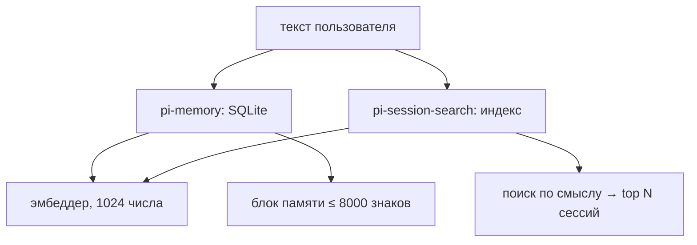

# pi-memory и pi-session-search: устройство, встраивания, консолидация и лимиты

Разбор по исходному коду `@samfp/pi-memory 1.6.1` и `pi-session-search 1.6.1` с учётом патчей сборки. Документ объясняет, где лежат данные, что и когда уходит в embeddings, как работают автоинъекция и консолидация, какие есть лимиты и что именно чинит сборка. Все значения — из кода; если поведение зависит от настроек, это указано отдельно.

Связанные документы: [паспорт компонентов](../components/history-memory.md), [контракт фиксов памяти](../fixes/memory.md), [границы проектов](../fixes/memory-injection.md), [поиск по сессиям](../fixes/session-search.md), [провайдер и embeddings](../polza-memory.md).

## 1. Две системы, одна модель



- **`@samfp/pi-memory`** — долговременные факты, уроки, события. Основное хранилище — SQLite.
- **`pi-session-search`** — поиск по прошлым разговорам. Источник истины — JSONL-файлы сессий; индекс производный.

Обе используют эмбеддер из своей конфигурации (в сборке — `qwen/qwen3-embedding-8b` через `openai-compatible`, 1024 числа). Это не общий индекс и не общая база: у каждой свои файлы, свой конфиг и свой жизненный цикл.

## 2. Хранилища

### 2.1 Память — настоящая SQL-база

Путь по умолчанию: `~/.pi/memory/memory.db` (общая для профилей, если не задан `pi-memory.localPath` в настройках проекта). Режим WAL, `busy_timeout = 5000`.

| Таблица | Поля | Назначение |
|---|---|---|
| `semantic` | `key`, `value`, `confidence`, `source`, `created_at`, `updated_at`, `last_accessed`, `embedding BLOB` | факты: `pref.*`, `user.*`, `tool.*`, `project.<scope>.*` |
| `lessons` | `id`, `rule`, `category`, `source`, `negative`, `is_deleted`, `created_at`, `project` | исправления и подтверждённые приёмы |
| `events` | `id`, `event_type`, `memory_type`, `memory_key`, `details`, `created_at` | служебный журнал |
| `semantic_fts`, `lessons_fts` | FTS5 | поиск по словам |

Вектор факта — 1024 числа float32 = **4096 байт** в `embedding`. Источник истины — сама база. Патч сборки базу не переписывает; копия делается вне Git.

### 2.2 Поиск — производный индекс

Источник истины — файлы разговоров: `~/.pi/agent/sessions/<слаг>/<дата>_<uuid>.jsonl` и `sessions-archive`. Индекс: `~/.pi/session-search/index/`.

| Файл | Что это |
|---|---|
| `session-index.json` | версия 3: метаданные сессий + вектор каждой сессии (base64) |
| `hybrid-fts.db` | SQLite FTS5 для словесного поиска |
| `sessions-fts.db` | словесный индекс режима без эмбеддера (`FtsSessionIndex`) |

Индекс можно удалить и перестроить — разговоры не пострадают. Он **не обновляется при чтении**: `session_list`, `session_read` и стартовая подсказка работают с тем, что уже сохранено. Отставший индекс молча не находит сессию. `sync()` сравнивает размер JSONL, а `save()` переписывает JSON целиком.

## 3. Встраивания: что, когда и сколько

Вектор — это набор чисел, мера смысла. Сравнение — косинус. Никакого «понимания» нет: близкие числа означают похожий текст.

### 3.1 Память

| Событие | Что считается | Объём | Ждёт ли Pi |
|---|---|---|---|
| `memory_remember` | запись: ключ без первого сегмента + значение | 1 запись = 1 запрос | нет, fire-and-forget |
| Старт сессии | записи без вектора или с чужой размерностью | до **64**, пачками по **16** | нет, в фоне |
| Каждый ход пользователя | текст вопроса с инструкцией Qwen | 1 запрос, десятки–сотни токенов | **да**, до старта модели |
| `memory_search` | текст запроса | 1 запрос | **да** |
| Консолидация | **ничего** | — | — |
| Уроки | **никогда** | — | — |

Следствие: факты, выписанные консолидацией, при записи вектора не получают. Они сразу ищутся по словам, а вектор появится только на следующем старте сессии через backfill. До перезапуска смысловой поиск их не видит.

Префикс Qwen добавляется только к поисковому вопросу (`Instruct: Given a web search query, retrieve relevant passages that answer the query\nQuery:`). Документы (факты) и FTS-запрос остаются сырыми.

### 3.2 Поиск сессий

| Событие | Что считается | Объём |
|---|---|---|
| Старт каждого процесса Pi | изменившиеся/новые сессии (усечённая выжимка) | все изменившиеся, пачками по **20** |
| Таймер (по умолчанию 5 мин) | то же | то же |
| `/session-sync` | то же | то же |
| `/session-reindex` | **все** сессии | все документы индекса |
| `session_search` | текст вопроса | 1 запрос |
| `session_list`, `session_read`, стартовая подсказка | ничего | — |

Одна выжимка на сессию: имя, **первые 6000** знаков сообщений пользователя, **3000** ответов ассистента, **4000** пересказов сжатия, **2000** пересказов веток, проект, cwd, изменённые файлы. `buildEmbeddingText` режет сборку до 16000 знаков, затем эмбеддер — до **12000**. Оценочно насыщенная русская сессия даёт около 7,5 тыс. токенов на документ.

В выжимку **не попадают**: размышления (`thinking`), результаты инструментов (только имена файлов из read/write/edit), полный хвост разговора. Поэтому индекс помнит начало длинной беседы, а не её конец.

Стоимость зависит от тарифа провайдера: пачка до 20 документов уходит одним вызовом `embedBatch`, внутри — HTTP-батчи до 100 текстов; один документ — ~7,5 тыс. токенов, вопрос — десятки–сотни. Полный `reindex` — самая дорогая операция, потому что считает все сессии.

## 4. Автоинъекция памяти

1. `before_agent_start` получает текст пользователя. Сбрасывает прошлый блок. Если тип не `user` или текст пустой — выходит.
2. `searchMemory(query, 15)`:
   - FTS5 по фактам, пул `max(15*2, 20) = 30`;
   - если эмбеддер настроен: вопрос → вектор → косинус по векторам фактов, тот же пул;
   - списки сливаются RRF, остаётся 15. Ошибка эмбеддинга → тихий откат на слова.
3. `buildSelectiveBlock`:
   - стартует с гибридных 15, добавляет словесные попадания и до 5 фактов текущего проекта;
   - фильтрует **всё** по `projectFactScope` (алиасы из `memory.factProjectAliases`);
   - расширяет «соседей» по префиксу ключа: до 20 для смыслового попадания, до 5 для словесного;
   - уроки: 3 местных, затем FTS по запросу, затем по слагу проекта, затем 10 общих; фильтр по проекту; максимум 15.
4. Укладка: факты **4300** знаков, запреты **2900**, удачные приёмы **1800**; общий потолок **8000**. Квоты мягкие: если после первого прохода остаётся место, `fitMemorySections` добирает записи из остатка до 8000. Режется только целыми записями.
5. Хук `context` вставляет готовый блок как временное сообщение **перед последним сообщением пользователя** — на каждом вызове модели внутри хода, включая продолжения после инструментов. Блок один на ход, повторно не считается.

Блок не пишется в системный промпт, историю сессии и консолидацию. В начале нового хода и на смене сессии сбрасывается; пустой или служебный запрос его не наследует.

Настройки: `memory.perTurnInjection` (по умолчанию `true`), `memory.injectionMode` (`context-hook` по умолчанию или legacy `system-prompt`), `memory.lessonInjection` (`all` или `selective`).

`perTurnInjection: false` отключает поиск на каждом ходу: при `session_start` один раз собирается fallback-блок (без промпта), вставляется скрытым сообщением `pi-memory-context` и дедуплицируется по истории; эмбеддинг вопроса не вызывается. `injectionMode: "system-prompt"` — legacy: блок дописывается в системный промпт; `"context-hook"` (по умолчанию) — временное сообщение перед последним сообщением пользователя.

**Что чинил патч:** stock 1.6 в автоинъекции использовал только FTS. Патч заменил вызов на `searchMemory` — вернул векторный recall. Плюс фильтр проекта для смысловых попаданий и «соседей», сброс блока в начале каждого run.

## 5. Консолидация

### 5.1 Когда запускается

- **выход из Pi** (`session_shutdown`): `/exit`, Ctrl+D, закрытие окна терминала — когда процесс Pi завершается штатно. Это не «конец ответа» и не простой: пока Pi работает, консолидации нет;
- **переключение сессии** (`session_before_switch`): `/new`, `/resume`, форк — старая сессия консолидируется в этот момент;
- **вручную** `/memory-consolidate`.

Порог: **≥3** сообщения пользователя для выхода и переключения, **≥2** для команды. Если порог не набран, консолидация не запускается. При аварийном завершении (kill, падение, выключение питания) hook может не выполниться, и сессия останется неконсолидированной. Ошибки и таймауты глотаются: сессия закрывается без записи, повтора нет.

При `session_start` накопленные ходы засеиваются из текущей ветки (до 240 ходов), поэтому резюм-сессия может консолидировать и историческую часть, а не только новые сообщения.

### 5.2 Как запускается

Дочерний процесс Pi, один вызов модели, без инструментов и без сессии:

```text
pi -p "<весь промпт>" --print --no-extensions --no-tools --no-session --model <модель>
```

На Windows вместо `.cmd`-шима запускается `node <...>\dist\bundle\cli.js` с теми же аргументами; корень npm берётся из `PI_AGENT_BUILD_NPM_PREFIX`, иначе `%APPDATA%\npm`.

`--no-extensions` — в дочернем процессе не загружаются плагины (ни память, ни поиск); `--no-tools` — без инструментов; `--no-session` — без файла сессии; `-p`/`--print` — неинтерактивный режим. Сам промпт — позиционный аргумент, а не значение `-p`.

Модель: `memory.consolidationModel` из приватных настроек профиля. В сборке — `polza-memory/deepseek/deepseek-v4.1-flash`. Если поле не задано, upstream-дефолт — `claude-sonnet-4-20250514`; без соответствующей авторизации такой запуск не сработает.

### 5.3 Что внутри промпта

| Часть | Значение по умолчанию |
|---|---|
| Инструкция извлечения | ~3035 знаков |
| Строка допустимого scope проекта | ~230 знаков |
| Текущая память: факты | 200 штук, до **1500** знаков |
| Текущая память: уроки | 100 штук, до **500** знаков |
| Разговор: пар | последние **30** сообщений пользователя |
| Сообщение пользователя | до **1000** знаков |
| Ответ ассистента | до **500** знаков |
| Таймаут процесса | **45 с** |
| Жёсткий обрыв | **60 с** |

Пара строится по упорядоченному потоку: сообщение пользователя + ближайший следующий текстовый ответ ассистента до следующего пользователя. Берутся последние 30 пользовательских сообщений (из удержанных 240 ходов), а не первые. Thinking и результаты инструментов не входят; `extractText` берёт только текстовые блоки.

Это поведение сборки. В stock 1.6.1 было иначе: первые 30 из удержанных 60.

### 5.3.1 Что требует stock-промпт и чего в нём нет

- Категории: `pref.` — стиль и привычки; `project.<name>.` — паттерны проекта; `tool.` — инструменты; уроки — исправления; удачные приёмы.
- Запрещено извлекать: код, архитектуру, пути и структуру проекта, git-историю, отладочные рецепты, содержимое AGENTS/CLAUDE, временное состояние, пересказ активности, содержимое файлов, одноразовые команды.
- Проблемы: пункт 2 разрешает «architecture decisions», а список запретов называет архитектуру выводимой; `pref.` и `tool.` пересекаются («tool preferences» в обоих); `user.*` в тексте не описан, хотя патч объявляет его глобальным; правила выбора области нет — модель решает по названию категории.
- Рабочее правило (рекомендация): при шансе 30–40 %, что знание понадобится в других проектах, — универсальный ключ (`pref.*`, `user.*`, `tool.*`, два сегмента); узкое правило одного проекта — `project.<scope>.*`. В stock-промпте его нет.

### 5.4 Реальный потолок — командная строка Windows

Промпт передаётся позиционным аргументом; `-p`/`--print` — флаг неинтерактивного режима. Предел всей командной строки на Windows — около **32 760 знаков**. Накладные расходы промпта (инструкция + память + scope + cwd + заголовки) ≈ 5,4 тыс. знаков. Значит на разговор остаётся ~25–26 тыс.

При 30 полных парах (1000 + 500) разговорная часть может достигать ~45 тыс. знаков, а весь промпт — ~50 тыс., то есть выше предела. Тогда `pi.exec` падает, ошибка проглатывается, и консолидация молча пропускается. Поэтому при увеличении лимитов нужен бюджет по знакам, а не только по парам.

Отдельного флага «прочитать промпт из stdin» в `pi --help` нет: промпт передаётся позиционным аргументом. Поведение при пустом промпте и поданном stdin не проверялось. `@files` в usage есть, но поведение при `--no-tools` не проверено. Передача через временный файл требует инструментов у ребёнка и ломает «один вызов без инструментов».

### 5.5 Что происходит с результатом

Ответ модели парсится как JSON:

```json
{"semantic":[{"key":"pref.x","value":"...","confidence":0.9}],
 "lessons":[{"rule":"...","category":"...","negative":true}]}
```

- факты: confidence ≥ 0.8, ключ валиден, значение ≤ 500 знаков;
- до записи `isDerivableOrEphemeral` отбрасывает ключи с path/dir/location/structure/layout, суффиксом `.architecture`, commit/git.history, значения «today…», «we worked on…», «this session…», код-блоки >300 знаков, current_task/in_progress; `isDerivableLesson` отбрасывает правила «file X is at/in», «the project uses…», «we fixed/deployed…», «run: …», «when error… run: …»;
- уроки: непустое правило, категория по умолчанию `general`; дедуп — точное совпадение и Jaccard ≥ 0.7;
- scope: чужой `project.*` **отбрасывается** с сообщением в stderr, а не переписывается; разрешённый префикс приходит из строки scope;
- уроки консолидации: `lessonProject = source === "user" ? undefined : project`, поэтому **каждый урок привязан к текущему проекту**; универсальный урок через консолидацию невозможен, `category: general` не помогает; глобальный урок — только через `memory_remember` (`source=user`);
- запись: `semantic` и `lessons` через store; **векторы не считаются** — только при следующем старте (backfill 64/16);
- `source` факта — `consolidation`, уроков — `session:<id>` (после патча; до него `session:unknown`);
- `setSemantic` сравнивает только `confidence`: при равном или большем запись перезаписывается, `source` не проверяется. `memory_remember` пишет `source=user, confidence=0.95`, но защита от перезаписи кодом не гарантирована.

### 5.6 Как перенастроить

Значения живут в двух местах:

- **живая установка** — `dist/index.js` установленного пакета (не `src/`: он не исполняется);
- **сборка** — блок `P2_PAIRS_TO` в `patches/memory-windows-runtime/apply.py`; таймауты — stock-константы, для них нужен отдельный якорь.

После правки живого `dist` патч сборки перестаёт узнавать файл (другой хеш). Это ожидаемо: значения надо либо перенести в патч, либо восстановить исходный файл.

Безопасные границы при текущих накладных расходах:

- бюджет разговора ≤ 25 000 знаков;
- итоговый промпт ≤ 31 500 знаков;
- таймаут 90/120 с оценочно достаточен для 25 тыс. знаков на быстрой модели; это не измерялось.

Пример настройки (не значение по умолчанию): сообщение пользователя 5000, ответ ассистента 1200, бюджет разговора 25 000, память в промпте 2000/700, таймауты 90/120. При этом пары набираются с конца, а если очередная пара не влезает в бюджет — она и все более старые отбрасываются. Дополнительно нужна страховка: если итог всё же больше ~31 500, отбросить самые старые пары и записать это в stderr.

Чего не делать: резать разговор на куски и склеивать факты (map-reduce), добавлять ретраи и второй фоновый проход. Это ломает ваншот и добавляет лишние слои.

## 6. Синхронизация поиска

`sync` в `~/.pi/session-search/config.json` (Task — `<task>/session-search/config.json`):

| Поле | Смысл | По умолчанию |
|---|---|---|
| `interval` | период фоновой проверки, мс; `-1` — выключить периодику | 300000 (5 мин) |
| `initialDelay` | задержка стартового прохода; `0` — сразу, `-1` — пропустить | 0 |
| `disableForChild` | отключить собственный проход у неинтерактивного/дочернего процесса (`PI_SUBAGENT_DEPTH > 0` или `!stdin.isTTY`) | false |

Значение читается в `session_start`: после правки нужен `/reload` или новый процесс. Проход сравнивает **размер** файла сессии; если вырос — сессия разбирается заново, а в эмбеддинг уходит усечённая выжимка (16000 → 12000). Проход без потолка: обрабатывает все изменившиеся сессии пачками по 20; один HTTP-вызов несёт до 100 текстов.

Каждый процесс Pi держит свой таймер и свою копию индекса: `load()` один раз при старте, `save()` переписывает JSON целиком. Дедупликации между процессами нет: при N живых процессах одна и та же выросшая сессия может быть посчитана до N раз. Субагенты синкают по тем же правилам; `disableForChild: true` убирает только их собственный проход, а их сессии всё равно индексируются родителем (файлы лежат в общем дереве `sessions`).

Стартовая подсказка «Recent Sessions» ждёт индекс не дольше 1000 мс; сам синк ограничен 600 000 мс. `/session-reindex` пересчитывает все сессии — самая дорогая операция, не запускать «на всякий случай».

Подсказка — отдельный механизм: 5 последних сессий проекта, обрез до 1500 знаков, один раз в начале сессии; к памяти отношения не имеет. У Code и Task разные config/index, поэтому сессии одного профиля не находятся в поиске другого без явного `localPath`.

## 7. Что именно чинит сборка

### 7.1 Память (`patches/memory-windows-runtime`)

| Проблема | Исправление |
|---|---|
| Windows: консолидация запускала дочерний Pi через `.cmd` и падала | запуск через `node` + `cli.js` выбранного npm-префикса |
| Консолидация путала ходы разговора | session-local `pendingTurns`/`pushTurn`; пары user→assistant |
| Всегда читались настройки `~/.pi/agent/settings.json`, Task не видел свой конфиг | настройки из `PI_CODING_AGENT_DIR` |
| `ctx.sessionId ?? ctx.session?.id` всегда `undefined` → уроки `session:unknown` | `sessionManager.getSessionId()` |
| Чужие факты протекали в проект: фильтр проверял только FTS, смысловые попадания и «соседи» проходили мимо; на Windows слагом проекта был весь путь | единый `projectFactScope()` для recall, `memory_remember`, консолидации и промпта; алиасы |
| Блок 8000 знаков резал запись посередине | режется только целыми записями, квоты 4300/2900/1800 |
| Автоинъекция 1.6 использовала только FTS | возвращён `searchMemory` (FTS + вектор + RRF) |
| Вопрос Qwen уходил без инструкции, как документ | query-префикс только для вопроса; документы и FTS не трогаются |
| Блок памяти наследовался в пустой/служебный запрос | сброс в начале каждого run, на старте и смене сессии |

### 7.2 Поиск (`patches/session-search-profile`)

| Проблема | Исправление |
|---|---|
| Неизвестная модель тихо скатывалась на слова | обязательный точный `modelPrefixes`, иначе ошибка до запроса |
| Смешивание FTS и смысла портило русские запросы | режим `semantic-only` (только косинус) |
| Task не мог держать свои конфиг и индекс | раздельные пути Code/Task, source roots в worker |
| `~` ломался без `HOME` | пути через `homedir()` |
| В выдаче показывался слаг | настоящий `cwd`, если доступен |
| Синк мог удалить записи при недоступном каталоге | удаление только из успешно прочитанного дерева |
| В старом FTS терялись ID | восстановление из сохранённой метаданных при загрузке |
| main и worker расходились в поведении | общие правила в обоих |

Все патчи локальные. Штатное обновление плагина их стирает; перенос — отдельная работа по [PATCH.Maintenance](../../instructions/PATCH.maintenance.instructions.md).

## 8. Все лимиты одним списком

| Лимит | Значение |
|---|---|
| Блок памяти в промпте | 8000 знаков |
| Квоты блока | факты 4300, запреты 2900, приёмы 1800 (мягкие; общий потолок 8000) |
| Фактов на инъекцию | 15 (пул 30) |
| Уроков на инъекцию | 15 (3 местных + FTS + слаг + 10 общих) |
| Соседи по префиксу | 20 (смысловое), 5 (словесное) |
| Backfill векторов | 64 записи за старт, 16 в запросе |
| HTTP-батч эмбеддера | 100 текстов |
| Выжимка сессии | 6000 / 3000 / 4000 / 2000; сборка 16000; отправка 12000 |
| Сессий в пачке синка | 20 (проход без потолка; HTTP-батч до 100) |
| Период синка | 300000 мс по умолчанию |
| Промпт консолидации | 30 пар; 1000/500 знаков |
| Память в промпте консолидации | 200 фактов / 1500 знаков; 100 уроков / 500 |
| Таймауты консолидации | 45/60 с |
| Командная строка Windows | около 32 760 знаков |
| Значение факта | ≤ 500 знаков; confidence ≥ 0.8 |
| Удержание ходов | 240 turns; 60 user + 60 assistant |
| Порог консолидации | 3 сообщения (shutdown/switch), 2 (`/memory-consolidate`) |

## 9. Риски и пробелы

- **Дубль эмбеддингов поиска.** Нет дедупликации между процессами: при N живых процессах одна сессия может быть пересчитана до N раз. Интервал уменьшает частоту, но не убирает дубли.
- **Гонка за индекс.** `save()` переписывает весь JSON; «кто последний сохранил — тот и прав». Записи, добавленные другими процессами, могут потеряться и потом пересчитаться заново.
- **Тихий пропуск консолидации.** Переполнение командной строки, таймаут и ошибка парсинга не приводят к повтору; сессия просто закрывается.
- **Факты без вектора.** После консолидации до следующего старта они ищутся только по словам.
- **Уроки без вектора.** Уроки не эмбеддятся; смысловой поиск их не находит.
- **Перезапись слов владельца.** `setSemantic` не проверяет `source`: консолидация с равным или большим confidence может заменить запись, созданную `memory_remember` (0.95).
- **Уроки всегда проектные.** Консолидация ставит текущий проект каждому уроку; универсальные уроки — только через `memory_remember`.
- **Промпт не задаёт область.** В stock-промпте нет правила «проект или глобальное», а `architecture` одновременно разрешена и запрещена.
- **Вопрос в эмбеддер ждётся.** Автоинъекция блокирует старт хода на один сетевой запрос; явного таймаута нет.
- **Патчи локальные.** Reinstall стирает; обновление плагина требует переноса.

## 10. Как менять и проверять

1. Снять before-хеши изменяемых файлов; убедиться, что копии профилей совпадают.
2. Скопировать в приватный каталог резервных копий с receipt (пути, хеши, размеры, значения).
3. Править только `buildConsolidationPrompt` и таймауты в `consolidateSession`.
4. Проверить синтаксис ESM, прогнать синтетику (40 пар по 6000/2000) и несколько реальных сессий; итог ≤ 31 500.
5. Проверить, что diff не содержит посторонних хунков и маркеры патча на месте.
6. Перезапустить Pi: старые процессы держат старый код в памяти.
7. Только после успешной проверки переносить значения в `apply.py` (P2-блок + якорь таймаутов) и в документацию.

## 11. Статус проверки

- Сверено с исходным кодом 1.6.1 и патчами сборки: лимиты, порядок вызовов, флаги, схема БД, маршруты эмбеддингов.
- Синтетика: harness на вырезанной функции сборки промпта для варианта настройки (40 пар), проверка бюджета и обрезки.
- **NOT TESTED:** реальный прогон консолидации с расширенными лимитами на живой модели, качество извлечения после расширения, поведение `@files` при `--no-tools`.
