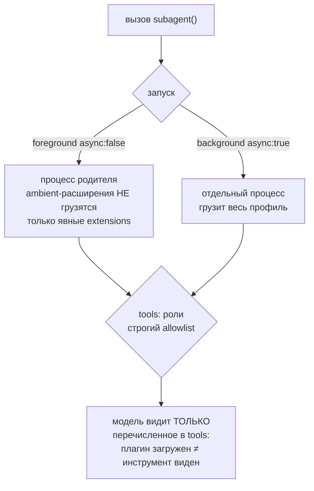

# Подагенты (pi-subagents): запуск, контекст, роли, инструменты

Разбор по исходникам `pi-subagents` 0.88.0, шаблонам сборки и живым пробам (2026-11-24). Отвечает на вопросы: чем foreground отличается от background, что такое fresh/fork, какие роли есть, почему плагин загружен а инструмента нет, как MCP выдаётся сабам и как настроить свою роль. Всё, что не подтверждено, помечено «нет данных».

Связанные документы: [компонентный паспорт](../components/coordination.md) (установка/удаление), [MCP для сабов](../subagent-mcp-tools.md) (короткая выжимка про MCP).

## Шпаргалка

| Запуск | Контекст | Расширения (плагины) | Инструменты | MCP |
|---|---|---|---|---|
| **foreground** (`async:false`) | `fresh`/`fork` | только явно указанные (`extensions`), ambient — нет | только из `tools:` роли | **нет** (требует background) |
| **background** (`async:true`) | `fresh`/`fork` | все профиля (ambient) + явные | только из `tools:` роли | да, адресные, по `tools:` |

Две независимые настройки: **запуск** (foreground/background) решает, что *загружено*; **роль** (`tools:`) решает, какие инструменты *видит модель*. Они не заменяют друг друга.



## Типы запуска

| | foreground (`async:false`) | background (`async:true`) |
|---|---|---|
| Где выполняется | внутри процесса родителя (`host: parent`) | отдельный процесс runner (`host: runner`) |
| Родитель ждёт ответа | да (блокируется) | нет, результат приходит позже |
| Ambient-расширения (авто, весь профиль) | **не грузятся** (в коде: `ambientExtensions = host === "runner"`) | **грузятся** |
| Явные расширения (`extensions`/`subagentOnlyExtensions`) | грузятся, если прописаны явно | грузятся |
| MCP-инструменты | **недоступны** (требуют background) | доступны (адресные, по `tools:`) |
| Зачем | быстро, базовые инструменты, без плагинов | когда нужны плагины, MCP, долгая работа |

Ключевой нюанс точности: foreground **не грузит ambient-расширения вообще**, но может загрузить **конкретные** расширения, если явно указать их путь в `extensions`/`subagentOnlyExtensions` (или path-подобной записью в `tools`), сохранив имя каждого инструмента в `tools`. MCP-инструменты это не спасает: их дают только background-дети (ambient-расширения, регистрирующие MCP, загружаются только там).

## Контекст: fresh vs fork

Это **не** то же самое, что foreground/background. Это про историю разговора.

- **`fresh`** — чистый лист. Саб знает только текст задания. Дёшево по токенам.
- **`fork`** — копия разговора родителя (переход ветки сессии). Саб видит предысторию. Дорого по токенам; **не является информационной изоляцией**.

Кто решает — приоритет, сверху вниз:

1. **вызов** — `options.context: "fresh" | "fork"` (или `contextForAgent`);
2. **`defaultContext` роли** (в frontmatter файла роли; переопределяется `agentOverrides` в settings);
3. **запасной вариант** — `"fresh"`.

Дефолты ролей: `worker` = `fresh`, `oracle` = `fork`, остальные не задают (берётся запасной `fresh` или выбор вызова). Ограничение: `fork` для **внешних CLI-агентов** (`claude-code`, `codex-exec`, `cursor-agent`) в background отвергается до старта («fork context» в неподдерживаемом).

### Resume форка

Resume/revive форка **не обогащает** его новым контекстом основной сессии: форк — замороженный снапшот на момент создания, а не живая ссылка на родителя.

| | Создание форка | Resume / revive форка |
|---|---|---|
| Что происходит | однократное ветвление `createBranchedSession(leafId)` — ветка-снимок (`src/shared/fork-context.js:136`; `forksDir` `:121`, «fork files never sit in the parent dir» `:117`) | продолжает **тот же** файл форка; читается сохранённый descriptor запуска (`context`, inherit-флаги, модель) — `src/runs/background/async-resume.js:271–279`, поля `:285–288` |
| Контекст основной сессии | видит контекст основной **на момент создания** | **не перечитывает** родителя — только свой снапшот + свои ходы |
| Что попадает в форк | снимок на момент ветвления | только явное resume/steer-сообщение |

- Создание — однократное ветвление, а не живая связь: дальше файл существует сам по себе.
- Resume продолжает тот же файл и **не** повторяет наследование разговора родителя: descriptor несёт `context`/`inherit*`/модель как зафиксированные параметры запуска, а не заново подтягивает историю.
- `parentSession` в шапке форка — метка родства (путь к `.jsonl` родителя), не живая связь.

**Живое подтверждение (2026-11-24).** В файле форка 0 совпадений с фразами основной сессии, пришедшими **после** точки форка; метки времени записей форка замерли на моменте форка. Сравнение: создание форка = видит контекст основной на этот момент; resume = только свой снапшот + свои ходы.

## Два фильтра: загрузка плагина vs список инструментов

Это главный источник ошибок. Две разные проверки:

| Фильтр | Что решает | Где задано |
|---|---|---|
| **1. Загрузка расширения** | какой код плагина вообще выполняется | тип запуска (ambient в background) + явные `extensions` |
| **2. Allowlist инструментов** | какие инструменты видит модель | `tools:` роли (строгий список) |

Фильтр 2 **не загружает код расширения** — это дословно из системы: «The `tools` field is a strict allowlist; it does not load extension code». Поэтому плагин может быть загружен, а его инструменты — отсечены, потому что их нет в `tools:` роли.

**Живое подтверждение (2026-11-24).** Фоновый `worker` (богатый `tools:` с `memory_*`) — `memory_stats` ответил живыми данными, значит плагин памяти загружен и работает. `serena_status` в том же сабе отсутствовал в списке инструментов. Оба — инструменты плагинов: память видна (есть в `tools:`), серены нет (нет в `tools:`). Одна и та же загрузка плагинов, разный видимый набор — разница ровно в allowlist роли.

## Плагин в контекст — инструменты и MCP нет

Загруженный плагин подсовывает свой **текст** (инструкции) в контекст саба автоматически. Его **инструменты** — нет, пока их нет в `tools:` роли. MCP-инструменты — тем более.

**Живое подтверждение (2026-11-24).** У фонового `reviewer` системный промпт содержал блок инструкций «Use codebase-memory for symbol, workflow…», но ни одного инструмента codebase-memory (`search_graph`, `read_symbols` и т.п.) в списке функций не было: **инструкция есть, средств нет**. Текст плагина просочился в контекст, а его инструменты отсёк allowlist роли.

## Роли

Роль — файл `agents/*.md` с frontmatter (кто он, какие инструменты, модель) и телом (системный промпт). Встроенные роли идут в пакете `pi-subagents`; свои создаются в `<PROFILE_DIR>/agents/<имя>.md`.

### Встроенные нативные роли

| Роль | `tools:` (allowlist) | `acceptanceRole` | `thinking` | `systemPromptMode` | `defaultContext` | Навыки (`inheritSkills`) | `AGENTS.md` (`inheritProjectContext`) |
|---|---|---|---|---|---|---|---|
| `worker` | read, grep, find, ls, bash, edit, write, contact_supervisor | writer | high | replace | `fresh` | false | true |
| `delegate` | read, grep, find, ls, bash, edit, write, contact_supervisor | — | наследует модель родителя | append | (наследуется) | false | true |
| `reviewer` | read, grep, find, ls, watchdog_diff, contact_supervisor | read-only | high | replace | (наследуется) | false | true |
| `scout` | read, grep, find, ls, bash, write, contact_supervisor | — | low | replace | (наследуется) | false | true |
| `oracle` | read, grep, find, ls, bash | read-only | high | replace | `fork` | false | true |
| `researcher` | read, write, web_search, fetch_content, get_search_content, source_check | — | medium | replace | (наследуется) | false | true |
| `evidence-auditor` | read, web_search, fetch_content, get_search_content, source_check | read-only | high | replace | (наследуется) | false | true |

Псевдонимы: `worker` = developer/coder/implementer/develop; `oracle` = advisor. `systemPromptMode: replace` — промпт роли **заменяет** системный целиком; `append` (у `delegate`) — дополняет. Навыки (`inheritSkills: false` у всех встроенных) **не наследуются**; `AGENTS.md` проекта виден (`inheritProjectContext: true`); глобальный контекст по умолчанию — нет. `defaultContext` задают только `worker` (`fresh`) и `oracle` (`fork`); у остальных выбор — на вызове, запасной `fresh`.

### Внешние CLI-роли

`runner.type: external-cli` — задача уходит во внешний CLI (stdin), а не в нативного саба. Все помечены `async: true` (фоновый запуск), `inheritSkills: false`, `inheritProjectContext: true`.

| Роль | CLI | `acceptanceRole` |
|---|---|---|
| `codex-exec` / `codex-exec-writer` | `codex` | — / writer |
| `claude-code` / `claude-code-writer` | `claude` | — / writer |
| `cursor-agent` / `cursor-agent-writer` | `cursor-agent` | — / writer |

`-writer`-варианты — явная запись в рабочее дерево; базовые — read-only анализ. Для внешних CLI в background `fork`-контекст отвергается (см. выше).

### Свои роли

Каталог `<PROFILE_DIR>/agents/` (пользовательский, обновления пакетов не трогают). Файл `<имя>.md`: frontmatter + тело-промпт. Перечисленные в `tools:` инструменты — единственный способ дать сабу инструмент расширения: имя инструмента в `tools:` + путь провайдера в `extensions`/`subagentOnlyExtensions` (для foreground обязательно; background грузит ambient сам).

Оверрайды встроенных ролей — `subagents.agentOverrides` в Pi settings: заменяют `tools:`/модель/контекст роли, не создавая нового файла.

## MCP у сабов

- **Адресные инструменты, не наследование.** Селектор `mcp:сервер` (или `mcp:сервер/инструмент`) из `tools:` роли разворачивается в конкретные инструменты сервера. Например `mcp:context7` → `context7_resolve-library-id`, `context7_query-docs`; `mcp:fetch` → `fetch_fetch`.
- **Только `fetch` + `context7`** — ограничение владельца (2026-11-18/20). Иные серверы сабам не выдаются.
- **Только background.** MCP-инструменты требуют фонового запуска; foreground отклоняется до старта.
- **Без общего прокси `mcp`.** Общий инструмент `mcp` даёт доступ ко всем серверам разом — сборка его сабам не даёт и не рекомендует (перечисляйте инструменты явно).
- Имена серверов берутся из `<PROFILE_DIR>/mcp-adapter.json`. В namespace Pi инструмент выглядит как `mcp__сервер__инструмент`. После добавления нового сервера нужен перезапуск Pi.

Подробнее — [MCP для сабов](../subagent-mcp-tools.md).

## Как настроить свою роль

1. Создайте `<PROFILE_DIR>/agents/<имя>.md`. Каталог пользовательский.
2. Frontmatter — кто он и что может:

   ```yaml
   ---
   name: my-helper
   description: Помощник с памятью и поиском сессий
   tools: read, grep, find, ls, bash, write, memory_search, session_search, contact_supervisor
   model: <провайдер/модель>          # опционально; без него — модель родителя
   thinking: high                      # опционально
   defaultContext: fresh               # fresh | fork (запасной — fresh)
   inheritProjectContext: true         # видеть AGENTS.md проекта
   inheritSkills: false                # наследовать ли навыки
   acceptanceRole: read-only           # read-only | writer (по договору приёмки)
   systemPromptMode: replace           # replace | append
   ---
   ```

3. Тело файла (после `---`) — системный промпт: кто он, что делает, чего не делает.
4. Чтобы дать инструмент расширения (память, поиск, серена, граф, ast): впишите **имя инструмента** в `tools:` **и** обеспечьте загрузку провайдера. В background плагин грузится сам (ambient); в foreground добавьте путь провайдера в `extensions`/`subagentOnlyExtensions`. Имя инструмента в `tools:` без загруженного провайдера не даст инструмент.
5. MCP: добавьте селектор `mcp:сервер/инструмент` в `tools:`, сервер — в `mcp-adapter.json`, запускайте **фоном** (`async: true`).
6. Альтернатива без нового файла — `subagents.agentOverrides` в Pi settings (замена `tools:`/модели/контекста встроенной роли).

## Наше состояние (сборка)

| | Code | Task |
|---|---|---|
| Пакетов | 15 | 12 |
| `pi-subagents` | есть (0.88.0) | есть (0.88.0) |
| `@nicknisi/pi-ast-grep`, `@bacnh85/pi-serena`, `pi-cbm` (граф кода) | есть | **нет** |

- Разница Code − Task — ровно три пакета code-intelligence: `pi-ast-grep`, `pi-serena`, `pi-cbm`. В Task их нет, поэтому serena/ast/граф там недоступны сабу **в принципе** (провайдера нет), независимо от `tools:`.
- **Патчей для `pi-subagents` в сборке нет** (в `patches/` их не заявлено).
- Сборка не создаёт готовых профилей сабов и не задаёт `subagents.*`/`agentOverrides` — это живая настройка пользователя. Пример пользовательской роли с MCP — `mcp-probe` (каталог `agents/`); пример оверрайда — расширенные `tools:` для `worker`/`delegate` (память, поиск сессий, `mcp:fetch`, `mcp:context7`).
- Загрузка пакетов координации закреплена в порядке **Subagents → Goal X → Intercom**.

## Как хранятся файлы сабов (fresh vs fork, артефакты, async-каталог, retention)

Файлы саба живут в трёх местах: его сессия — внутри каталога родительской сессии, артефакты — рядом, а для фонового запуска есть рабочий async-каталог во временном каталоге. Что где лежит и сколько живёт:

| Что и где лежит | Сколько живёт | Источник |
|---|---|---|
| **Сессия саба, `fresh` (не fork):** `~/.pi/agent/sessions/<проект>/<родитель-сессия>/<subagent-id>/run-<N>/session.jsonl`, `run-0` — первый прогон | до потолка **90 дней** (`RESUMABLE_RETENTION_DAYS`) | `src/api/preflight.js:307` (`path.join(sessionRoot,"run-0")`); `src/runs/foreground/subagent-executor.js:7470` (`run-${idx ?? 0}`) |
| **Сессия саба, `fork`:** `~/.pi/agent/sessions/<проект>/<родитель-сессия>/forks/<subagent-id>/<timestamp>_<uuid>.jsonl` | до потолка **90 дней** | `src/shared/fork-context.js:121` (`forksDir`), `:117` («fork files never sit in the parent dir») |
| **Артефакты:** `<...>/<родитель-сессия>/subagent-artifacts/<subagent-id>_<роль>_{input.md, meta.json, output.md, transcript.jsonl}` (иногда `outputs/<id>/`) | **7 дней** (`artifactConfig.cleanupDays`, default) | каталог — `src/shared/artifacts.js:172,182,278`; имена — `:194–198`; default — `src/shared/types.js:51` |
| **Async-каталог фонового runner'а:** `%TEMP%/pi-subagents-user-User/async-subagent-runs/<run-id>/` | **30 дней** (`ASYNC_RETENTION_DAYS`) | `src/runs/background/async-retention.js:15` |

### Детали

- **Отличить форк от fresh по пути:** у форка третий уровень `dirname` — `forks` (`src/shared/artifacts.js:379`); у fresh — каталог `<subagent-id>/run-<N>`. Обобщённый живой пример: fresh — `<id>/run-0/session.jsonl`; fork — `forks/<id>/<timestamp>_<uuid>.jsonl`.
- **Артефакты** — на каждый саб четыре файла `<subagent-id>_<роль>_…` (`input.md`, `meta.json`, `output.md`, `transcript.jsonl`), иногда в подкаталоге `outputs/<id>/`. Чистка по `artifactConfig.cleanupDays`, по умолчанию **7 дней** (`src/shared/types.js:51`, блок `:43–52`; используется в `src/extension/index.js:238–239`, `:866`).
- **Async-каталог** (`%TEMP%/pi-subagents-user-User/async-subagent-runs/<run-id>/`) — рабочий каталог фонового runner'а, retention-managed (удаляется чисткой). Внутри: `mission.json`, `events.jsonl`, `output-0.log`, `status.json`, `process-terminal.json` + `process-terminal-candidate.json`, `run-fanout-budget.json`, `runner.stdout.log`, `runner.stderr.log`, `subagent-log-<id>.md`, `control/`.
- **Retention-константы** (`src/runs/background/async-retention.js`): `ASYNC_RETENTION_DAYS = 30` (`:15`) — async-каталоги; `RESUMABLE_RETENTION_DAYS = 90` (`:21`) — потолок для файлов сессий (комментарий `:20`: «Session files outlive run dirs, so without a ceiling it is kept forever»); `ASYNC_RETENTION_DELAY_MS = 60_000` (`:17`); `ASYNC_RETENTION_TOMBSTONE_GRACE_MS = 24h` (`:18`); `LOCK_STALE_MS = 24h` (`:30`).
- Файлы сессий переживают async-каталоги: у сессий отдельный потолок 90 дней, а не 30 — иначе файл сессии жил бы вечно.

## Частые ошибки

1. **«Плагин есть → инструмент есть».** Нет. Загрузка плагина и видимость его инструментов — разные проверки. Инструмент появляется, только если прописан в `tools:` роли (а провайдер загружен).
2. **«MCP у сабов все».** Нет. Только адресные `mcp:сервер/инструмент` из `tools:`, только `fetch`+`context7` (по правилу владельца), только в background. Общего `mcp` сабам не дают.
3. **«Саб помнит разговор».** Только при `fork`. `fresh` (запасной) — чистый лист. `fork` — не изоляция и стоит токенов.
4. **«foreground получит плагины».** Нет. foreground не грузит ambient-расширения; инструменты расширений там требуют явного `extensions`, а MCP недоступен вовсе.
5. **«serena/ast дам в Task».** Невозможно: в Task пакетов code-intelligence нет.
